# HelpDesk — AI-Assisted IT Service Management System

A Salesforce-based IT Service Management (ITSM) application for managing employee IT support requests.

HelpDesk centralizes service requests and automates **priority assignment, support-queue assignment, SLA deadline calculation, resolution handling, SLA monitoring, AI-assisted issue reporting, and management reporting**.

Built as a hands-on Salesforce portfolio project using **Flow, Apex, Lightning Web Components, asynchronous Apex, REST API integration, Lightning Message Service, Reports & Dashboards, and automated testing**.

---

## Business Problem

Employees can report IT issues such as hardware failures, software problems, network issues, access requests, and email problems.

Without a centralized process, support teams need to manually categorize requests, determine priority, assign ownership, track deadlines, and monitor unresolved tickets.

HelpDesk provides a centralized Salesforce-based workflow:

```text
Employee
   ↓
Service Request
   ↓
Priority
   ↓
Support Assignment
   ↓
SLA Tracking
   ↓
Resolution
   ↓
Reports & Dashboard
```

Supported categories:

**Hardware · Software · Network · Access · Email · Other**

---

## Key Features

### 1. Service Request Management

`Service_Request__c` is the central object used to track employee IT issues.

Requests contain information such as:

- Subject
- Description
- Category
- Priority
- Status
- Assigned To
- SLA Deadline
- SLA Breached
- Resolution Notes
- Resolution Date

---

### 2. Priority Automation

A **before-insert / before-update Apex Trigger with a Trigger Handler** applies the default priority configured for the selected category when the user has not already selected a Priority.

Example:

```text
Hardware + blank Priority
        ↓
High

Hardware + Critical Priority
        ↓
Critical remains Critical
```

The implementation is bulk-safe and has been tested with **200 Service Requests in one transaction**.

---

### 3. Support Assignment

The **Service Request Assignment** Record-Triggered Flow:

- Determines the support-team branch
- Sets `Status__c` to `Assigned`
- Assigns `OwnerId` to the **IT Support Queue**

The current implementation uses a shared support queue. The support-team branching provides a structure that can be extended to category-specific queues in a future version.

---

### 4. SLA Automation

A separate **SLA Automation Flow** calculates the SLA deadline from the request Priority.

| Priority | SLA Threshold |
| -------- | ------------: |
| Critical |       4 hours |
| High     |       8 hours |
| Medium   |      24 hours |
| Low      |      48 hours |

The current implementation uses fixed elapsed-hour thresholds rather than Salesforce Business Hours.

A future version could make SLA rules configurable and Business Hours-aware.

---

### 5. Resolution Automation

The **Service Request Resolution Automation** Flow handles resolution-related automation.

When a request reaches `Resolved`, the flow automatically populates the Resolution Date.

This removes the need for the user to manually enter the date for the normal resolution workflow.

---

### 6. SLA Monitoring

The project uses **Batch Apex and Scheduled Apex** for periodic SLA monitoring.

```text
Scheduled Apex
      ↓
SLA Batch
      ↓
Check SLA Deadline
      ↓
Update SLA_Breached__c
```

Requests whose SLA deadline has passed are flagged using `SLA_Breached__c`.

The current implementation performs periodic breach detection rather than real-time escalation or notification.

---

### 7. Lightning Web Components

The project includes custom Lightning Web Components for:

- Service Dashboard
- Request List
- Request Details
- Request Summary
- Request Filtering
- AI-assisted issue reporting

**Lightning Message Service** is used where independent LWC components need to communicate without relying on direct parent-child communication.

---

### 8. AI-Assisted Issue Reporting

The AI Assistant allows an employee to describe an IT issue using natural language.

Example:

```text
"My VPN is not working."
          ↓
External LLM API
          ↓
Suggested category
Suggested subject
Suggested response
          ↓
Employee reviews the suggestions
          ↓
Standard Service Request form
```

The AI acts as an **assistant rather than an autonomous ticket creator**.

The employee reviews the suggestions before submitting the Service Request, and the AI does not automatically select the request Priority.

The external AI integration is tested using `HttpCalloutMock`, so unit tests do not make real API requests.

> **Data consideration:** The issue description is sent to an external AI service to generate suggestions. A production implementation should apply appropriate data-classification, privacy, credential-management, and third-party API controls before sending sensitive organizational information.

---

## Architecture

```text
Employee
   │
   ├── Standard Request Form
   │
   └── AI Assistant
          │
          └── External LLM API
   │
   ▼
Service_Request__c
   │
   ├── Apex Trigger + Handler
   │       └── Default Priority
   │
   ├── Assignment Flow
   │       └── IT Support Queue
   │
   ├── SLA Automation Flow
   │       └── SLA Deadline
   │
   └── Resolution Flow
           └── Resolution Date
   │
   ▼
LWC Dashboard
   │
   ├── Request List
   ├── Request Details
   └── Request Summary
   │
   ▼
Reports & Dashboard

Scheduled Apex
      ↓
SLA Batch
      ↓
SLA Breach Monitoring
```

---

## Data Model

| Object                | Purpose                                           |
| --------------------- | ------------------------------------------------- |
| `Service_Request__c`  | Central IT support ticket                         |
| `Service_Category__c` | Category reference data and default priority      |
| `Employee__c`         | Employee information used by the ITSM application |
| `IT_Asset__c`         | Company IT asset information                      |

`Service_Request__c` is the central business object connecting the request-management workflow.

---

## Technology Stack

| Area                    | Technology                                 |
| ----------------------- | ------------------------------------------ |
| Platform                | Salesforce                                 |
| Automation              | Salesforce Flow                            |
| Backend                 | Apex, Trigger, Trigger Handler             |
| Asynchronous Processing | Batch Apex, Scheduled Apex, Queueable Apex |
| Frontend                | Lightning Web Components                   |
| Component Communication | Lightning Message Service                  |
| Integration             | REST API                                   |
| AI                      | External LLM API                           |
| Testing                 | Apex Test Classes, `HttpCalloutMock`       |
| Reporting               | Salesforce Reports & Dashboards            |
| Version Control         | Git, GitHub                                |
| Project Tracking        | Jira                                       |

---

## Testing

The latest automated Apex test execution completed successfully:

```text
13 tests executed
13 passed
0 failed
93% org-wide Apex coverage
```

Important behaviors covered include:

- Bulk insertion of **200 Service Requests**
- Category-based default Priority
- Preservation of user-selected Priority
- Service Request controller operations
- SLA Batch execution
- SLA Scheduler execution
- Successful AI response handling
- AI failure handling
- Trigger and Trigger Handler execution

Selected Apex coverage:

| Class                          | Coverage |
| ------------------------------ | -------: |
| `ServiceRequestTriggerHandler` |     100% |
| `ServiceRequestTrigger`        |     100% |
| `SLAScheduler`                 |     100% |
| `SLARequestBatch`              |     100% |
| `AIAssistService`              |      95% |
| `ServiceRequestController`     |      84% |

Coverage is used as an indicator of tested code paths; the tests also verify specific business behaviors such as bulk processing and preserving user-selected Priority.

---

## Screenshots

### 01 — HelpDesk App

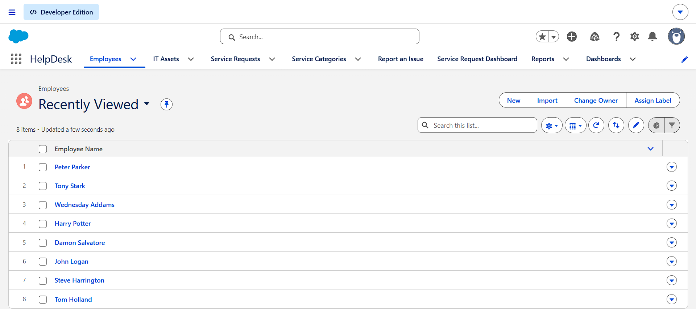

### 02 — Service Request Detail

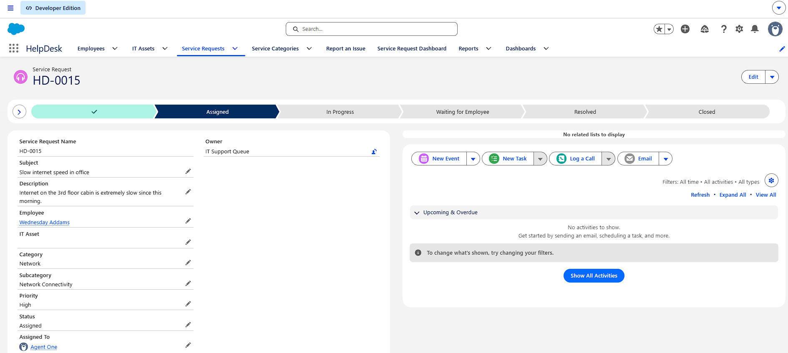

### 03 — Priority Automation

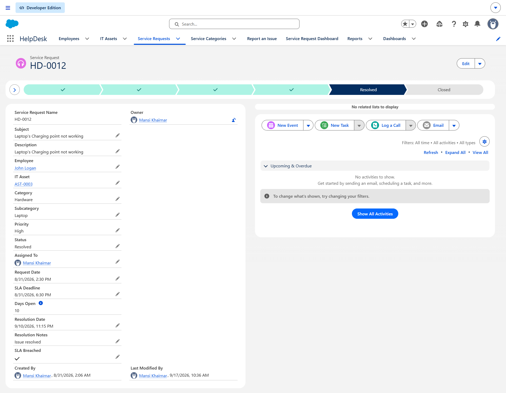

### 04 — Priority Override

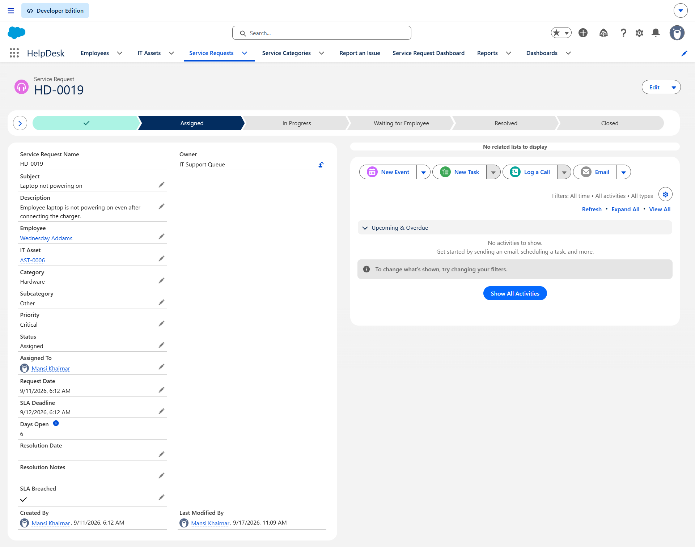

### 05 — Assignment Flow

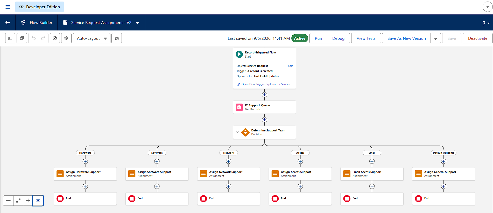

### 06 — Resolution Automation

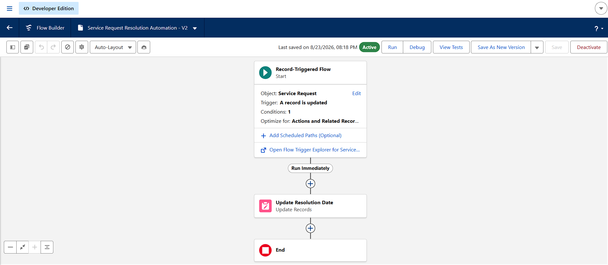

### 07 — SLA Automation

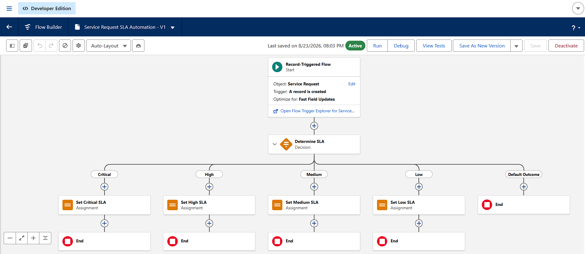

### 08 — Service Dashboard

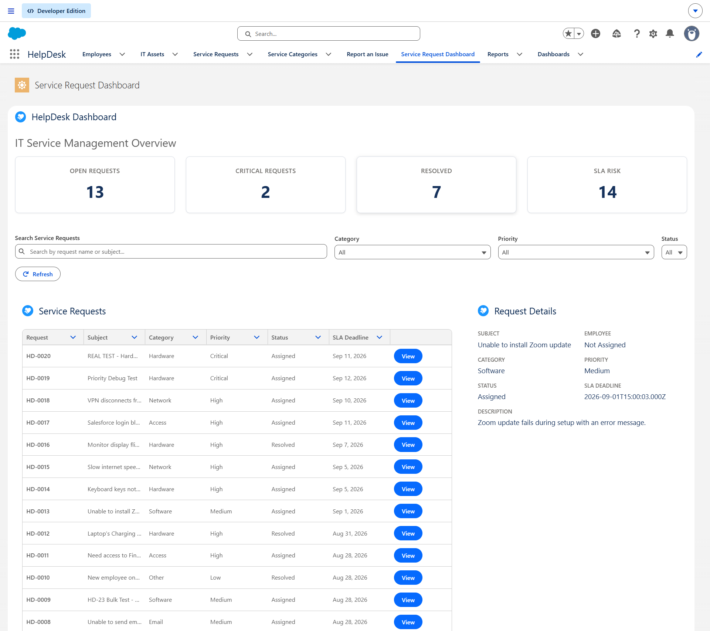

### 09 — AI Assistant

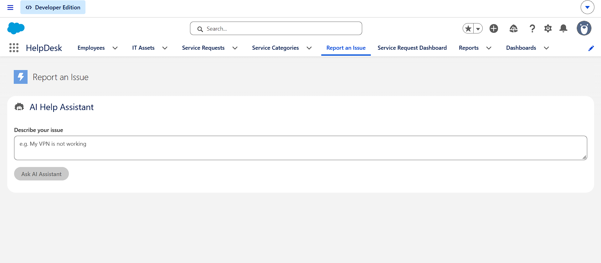

### 10 — AI Assistant Results

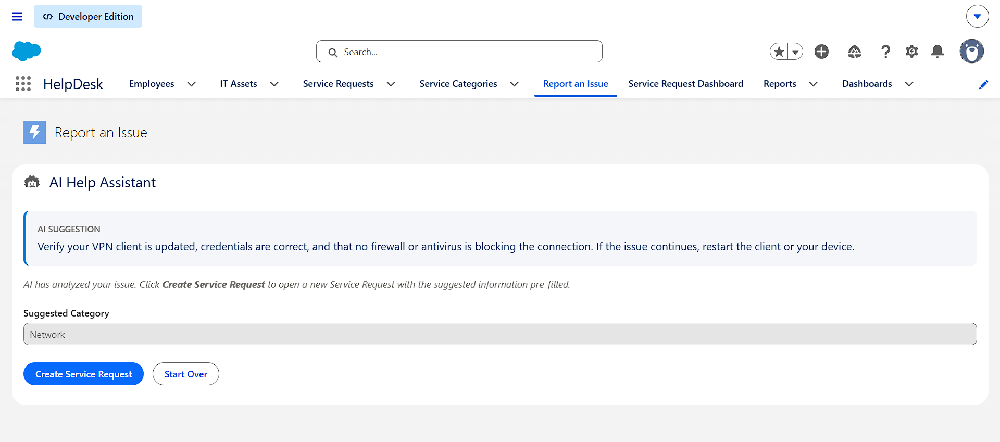

### 11 — Apex Test Results

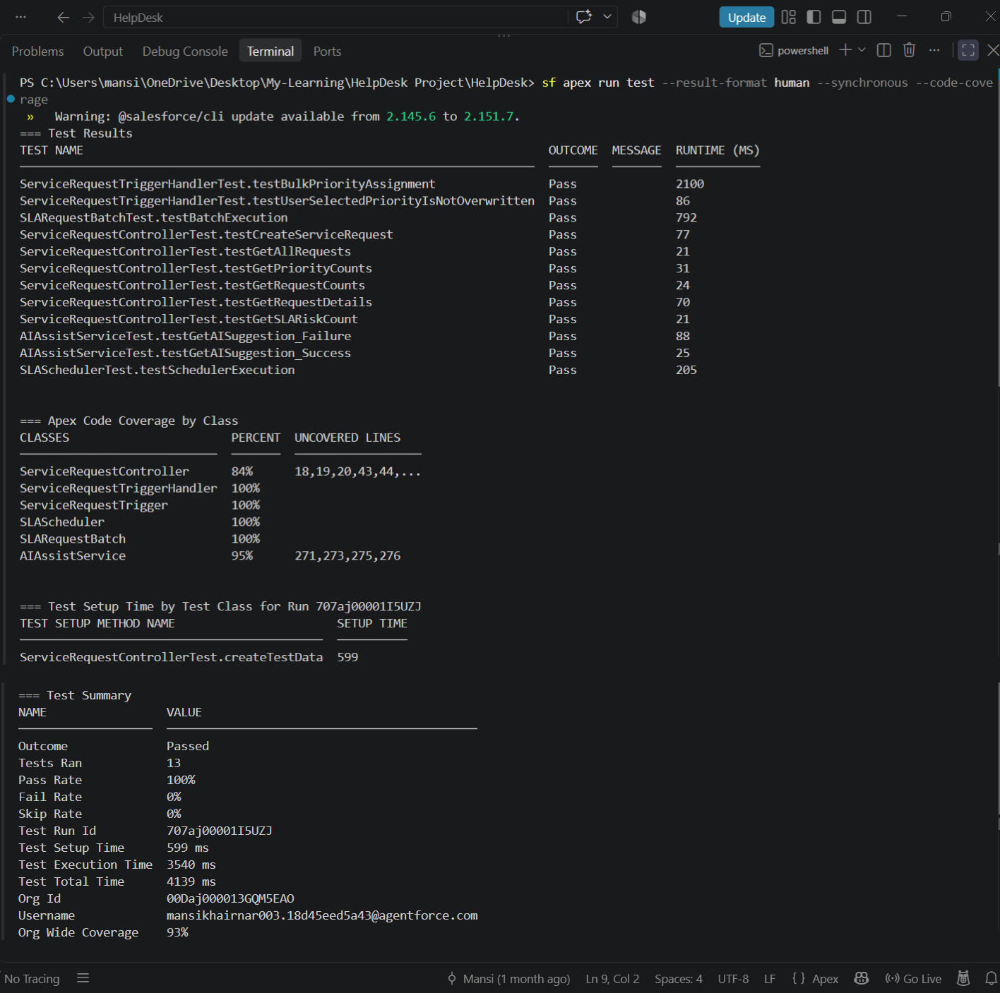

### 12 — Reports and Dashboard

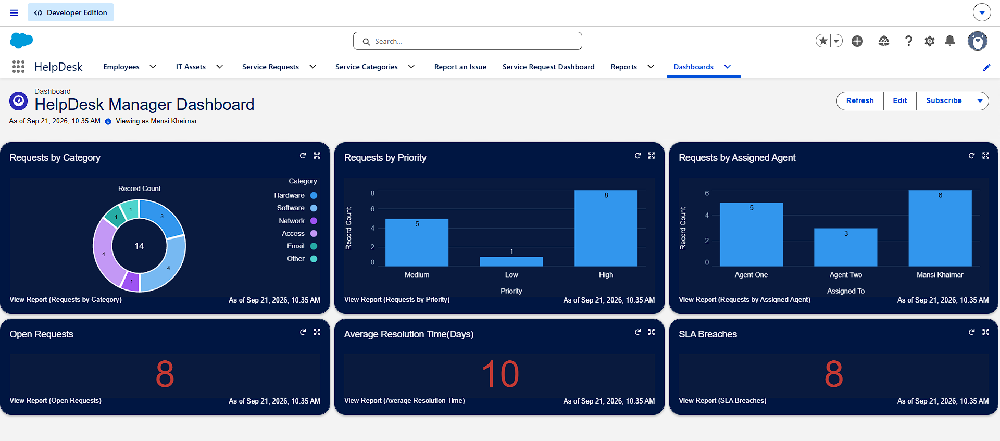

---

## Engineering Decisions

### Bulk-safe Apex

The Priority automation uses a Trigger Handler with collection-based processing rather than performing SOQL/DML inside a record loop.

The behavior is explicitly tested with 200 records.

### Preserve user input

The Trigger Handler only applies the category default when `Priority__c` is blank.

This prevents automation from silently overwriting an explicitly selected Priority.

### Separate automation responsibilities

The project separates responsibilities across Apex and Flow:

```text
Trigger Handler
    → Priority defaulting

Assignment Flow
    → Support Queue assignment

SLA Flow
    → SLA deadline

Resolution Flow
    → Resolution Date

Batch + Scheduler
    → SLA breach monitoring
```

This makes each automation responsible for a specific business process.

### Human-in-the-loop AI

The AI integration provides suggestions instead of automatically creating or prioritizing tickets.

This allows the employee to review the generated information before submission.

### Asynchronous SLA monitoring

Batch and Scheduled Apex are used for periodic SLA breach evaluation instead of processing every open request continuously.

---

## Known Limitations & Future Enhancements

- **Category relationship:** `Service_Request__c.Category__c` currently uses a picklist and the Apex logic matches it by name against `Service_Category__c`. A Lookup relationship would provide stronger referential integrity.
- **SLA calculation:** SLA thresholds currently use fixed elapsed hours and are not based on Salesforce Business Hours.
- **SLA escalation:** The current Batch process flags SLA breaches but does not implement notification or escalation workflows.
- **Support routing:** Requests currently use a shared IT Support Queue. Future routing could use dedicated queues for different support categories.
- **IT Asset lifecycle:** Asset assignment and checkout/return automation is outside the current project scope.
- **AI integration:** The current AI workflow sends the employee's issue description to an external service. Production deployment would require appropriate privacy and data-governance controls.

---

## Development & Project Tracking

Jira was used to create user stories and track implementation progress during development.

As an individual portfolio project, the work followed an **Agile-style task workflow** rather than a formal Scrum process with dedicated Scrum ceremonies.

---

## Setup

Deploy the Salesforce metadata to an authorized org:

```bash
sf project deploy start -d force-app
```

Some org-specific configuration must be completed separately, such as:

1. Creating/configuring the required **IT Support Queue**
2. Configuring the AI integration credentials
3. Configuring any required users, permissions, and org-specific settings

**Do not commit real API keys, credentials, or other secrets to GitHub.**

---

## Project Structure

```text
HelpDesk/
├── force-app/
│   └── main/default/
│       ├── classes/
│       ├── flows/
│       ├── lwc/
│       ├── messageChannels/
│       ├── objects/
│       ├── permissionsets/
│       ├── reports/
│       ├── dashboards/
│       └── customMetadata/
│
├── docs/
│   └── screenshots/
│       ├── 01-helpdesk-home.png
│       ├── 02-service-request-detail.png
│       ├── 03-priority-automation.png
│       ├── 04-priority-override.png
│       ├── 05-assignment-flow.png
│       ├── 06-resolution-flow.png
│       ├── 07-sla-automation.png
│       ├── 08-service-dashboard.png
│       ├── 09-ai-assistant.png
│       ├── 10-ai-assistant-results.png
│       ├── 11-apex-test-results.png
│       └── 12-reports-dashboard.png
│
├── README.md
└── sfdx-project.json
```

---
## Author

**Mansi Khairnar**
[LinkedIn](https://www.linkedin.com/in/mansi-khairnar-m310200k2) | [Trailhead](https://www.salesforce.com/trailblazer/mansi-khairnar)